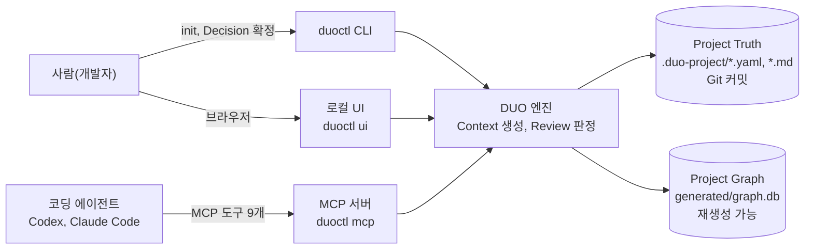

# DUO 설계 산출물

DUO(AI 코딩 에이전트용 프로젝트 방향 관리 도구)의 설계 산출물입니다. 모두 `next` 브랜치의 실제 코드와 문서를 기준으로 그렸습니다.

| 산출물 | 내용 |
|---|---|
| [ERD (데이터 모델)](erd.md) | Project Truth와 코드 구조를 잇는 Project Graph의 개념 ERD 2장, SQLite 물리 ERD, 엣지 10종 정의, 저장 위치 |
| [화면 와이어프레임](wireframes.md) | 로컬 UI(`duoctl ui`)의 화면 흐름도와 핵심 화면 6개(Overview, Pending decisions, Work map, Review, Graph, Context) |

## 시스템 한눈에 보기

- 에이전트는 MCP로 작업 맥락(Context)을 받고, 변경을 리뷰(Review)받고, Decision을 **제안**만 할 수 있습니다.
- Decision을 확정하는 것은 사람만 할 수 있습니다(CLI 또는 UI의 확인 절차).
- 자세한 아키텍처는 [02. System Architecture](../02-system-architecture.md)에 있습니다.
