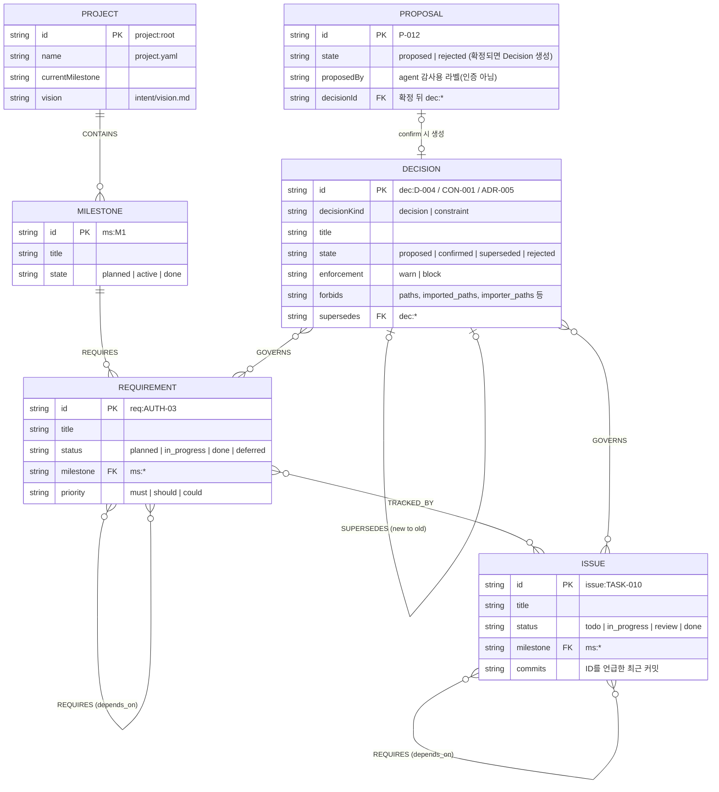
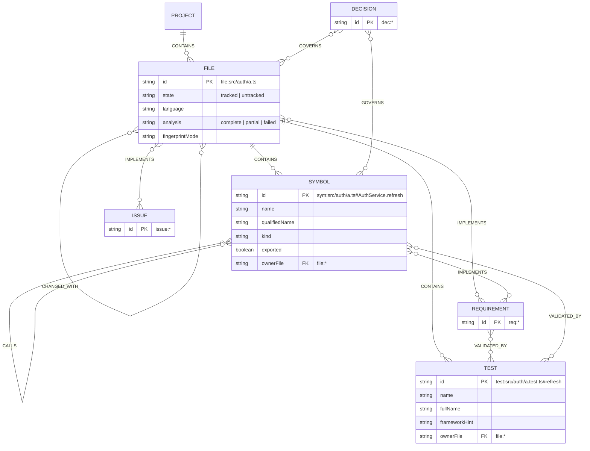
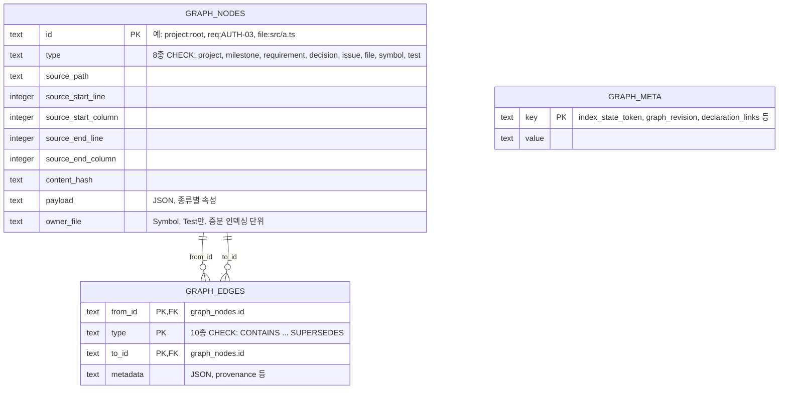

# DUO ERD (데이터 모델)

DUO는 사람이 확정한 프로젝트 의도(**Project Truth**)와 코드 구조를 하나의 **Project Graph**로 연결합니다. 이 문서는 그 데이터 모델을 세 단계로 보여 줍니다.

1. [개념 ERD — 의도(Truth) 영역](#1-개념-erd--의도truth-영역): 사람이 정하는 Milestone, Requirement, Decision, Issue, 그리고 Agent가 올리는 Proposal
2. [개념 ERD — 코드 영역과 연결](#2-개념-erd--코드-영역과-연결): File, Symbol, Test가 의도와 어떻게 이어지는지
3. [물리 ERD — SQLite `graph.db`](#3-물리-erd--sqlite-graphdb): 위 관계가 실제로 저장되는 테이블 3개

기준은 `next` 브랜치의 코드입니다(`packages/core/src/ids.ts`, `packages/graph/src/store/types.ts`, `packages/graph/src/store/node-sqlite/schema.ts`). 자세한 규칙은 [03. Data Model](../03-data-model.md)과 [04. Project Graph](../04-project-graph.md)에 있습니다.

> **읽는 법.** DUO의 관계는 외래 키 칼럼이 아니라 **그래프 엣지**(`IMPLEMENTS`, `GOVERNS` 등)로 저장됩니다. 아래 개념 ERD의 관계선 이름이 곧 엣지 타입입니다. `||` 는 정확히 하나, `o|` 는 0 또는 1, `o{` 는 0개 이상을 뜻합니다.

## 1. 개념 ERD — 의도(Truth) 영역

사람이 `.duo-project/` 아래 YAML·Markdown 파일로 관리하는 부분입니다. Git에 커밋되며, Agent는 Decision을 직접 만들지 못하고 **Proposal**만 올립니다. 사람이 확정(confirm)해야 Decision이 됩니다.



| 엔티티 | 저장 위치 | 만드는 주체 |
|---|---|---|
| Project | `project.yaml`, `intent/vision.md` | 사람(`duoctl init`/`setup`) |
| Milestone | `milestones/*.yaml`, `*.md` | 사람 |
| Requirement | `specs/*.md` | 사람 |
| Issue | `milestones/*.yaml`, `*.md` | 사람 |
| Decision | `decisions/D-###.yaml`·`*.md`, `intent/constraints.yaml` | **사람의 confirm으로만** 생성 |
| Proposal | `decisions/proposals/P-*.yaml` | Agent(MCP `duo_propose_decision`) 또는 사람. Graph 노드가 아님 |

## 2. 개념 ERD — 코드 영역과 연결

`duoctl index`가 저장소를 스캔해 만드는 부분입니다. 코드에서 다시 만들 수 있으므로 Git에 커밋하지 않습니다(`generated/`). 리뷰는 이 연결을 따라가 "이 변경이 어떤 Requirement와 Decision에 닿는지"를 판정합니다.



### 엣지(관계) 정의 — 10종

| 엣지 | 방향 | 근거 |
|---|---|---|
| `CONTAINS` | Project → Milestone·File, File → Symbol·Test, Symbol(class) → Symbol(member) | 구조 |
| `REQUIRES` | Milestone → Requirement, Requirement → Requirement, Issue → Issue | 사람이 선언(`depends_on`) |
| `IMPLEMENTS` | Symbol·File → Requirement, File → Issue | 선언(`implements.paths`·`symbols`) 또는 코드 주석(`duo: AUTH-03`) |
| `GOVERNS` | Decision → Requirement·Issue·File·Symbol | 선언(`governs`) |
| `TRACKED_BY` | Requirement → Issue | 선언(Issue의 requirements) |
| `VALIDATED_BY` | Symbol·Requirement → Test | 정적 분석(테스트 안 호출) 또는 선언 |
| `IMPORTS` | File → File | 정적 분석(TS/JS, Python, C/C++ quoted include만 해석) |
| `CALLS` | Symbol → Symbol | 정적 분석(정확히 해석된 호출만) |
| `CHANGED_WITH` | File ↔ File | Git 이력(최근 500 커밋 중 3회 이상 함께 변경) |
| `SUPERSEDES` | Decision → Decision(새 → 옛) | 선언(`supersedes`), 자기 참조·순환 금지 |

> Decision의 `forbids`(예: "UI는 legacy-db를 import하면 안 된다")는 엣지가 아니라 Decision의 속성입니다. 리뷰가 변경된 `IMPORTS`와 비교해 위반이면 `forbidden-import` claim을 만듭니다.

## 3. 물리 ERD — SQLite `graph.db`

위의 모든 노드와 엣지는 테이블 3개에 저장됩니다(`.duo-project/generated/graph.db`, Graph schema version 2). 노드 종류별 속성은 `payload` JSON에 들어갑니다.



| 테이블 | 키와 인덱스 | 비고 |
|---|---|---|
| `graph_meta` | PK `key` | 인덱스 상태 토큰, 그래프 리비전, C++ 선언·정의 쌍 |
| `graph_nodes` | PK `id`, 인덱스 `(type, id)`, `(owner_file, id)` | `type`은 CHECK 제약으로 8종만 허용 |
| `graph_edges` | PK `(from_id, type, to_id)`, 인덱스 `(to_id, type, from_id)`, `WITHOUT ROWID` | 양 끝은 `graph_nodes`를 참조하고 노드 삭제 시 함께 삭제(`ON DELETE CASCADE`) |

## 4. 데이터가 저장되는 곳 한눈에 보기

```text
.duo-project/
├─ project.yaml, intent/, specs/, milestones/   Project Truth (Git 커밋)
├─ decisions/D-*.yaml, decisions/proposals/      Decision · Proposal (Git 커밋)
├─ reviews/*.json                                 사람이 남긴 Review Record, Adoption Baseline (Git 커밋)
├─ generated/graph.db                             Project Graph (재생성 가능, Git 제외)
├─ generated/index-state.json, fingerprints.json  인덱스 신선도 판정 (재생성 가능, Git 제외)
├─ cache/                                         분석 캐시, Context Packet (Git 제외)
└─ runtime/                                       metrics, Work map 활동 (로컬 전용, Git 제외)
```

원칙은 하나입니다. **사람이 결정한 것은 Git에 남기고, 코드에서 다시 만들 수 있는 것은 Git에서 뺍니다.**
