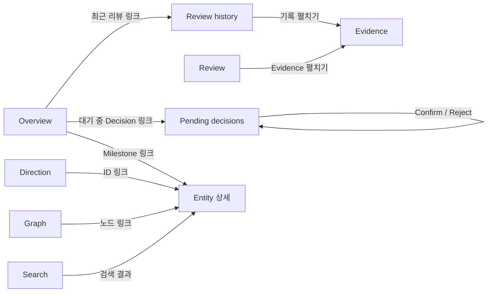
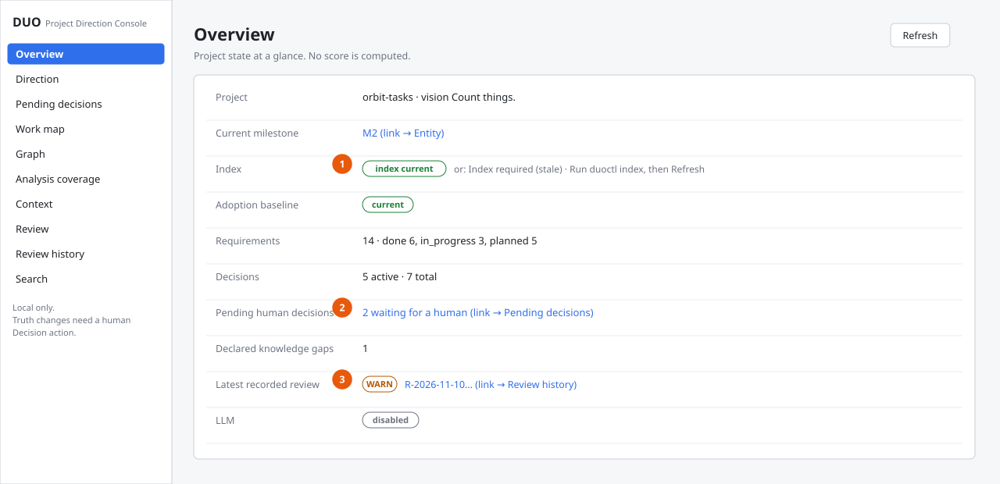
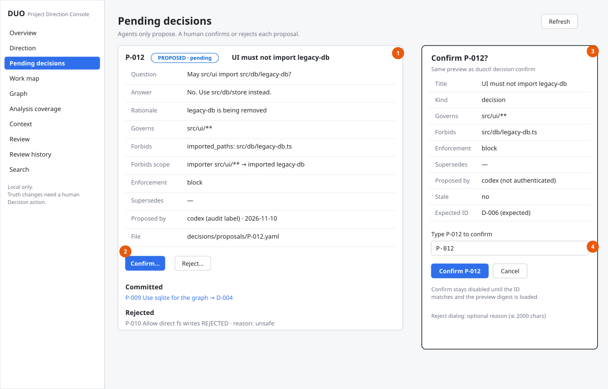
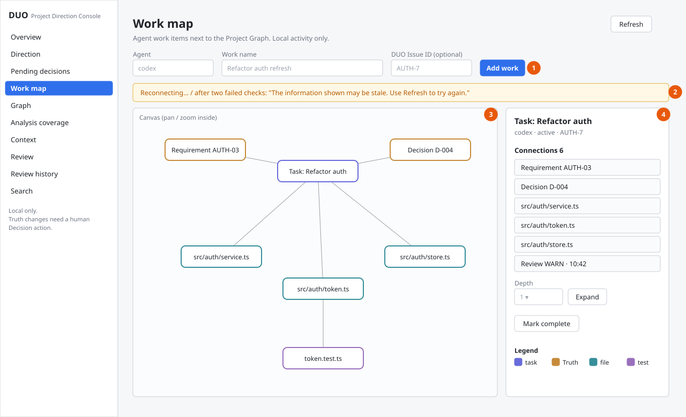
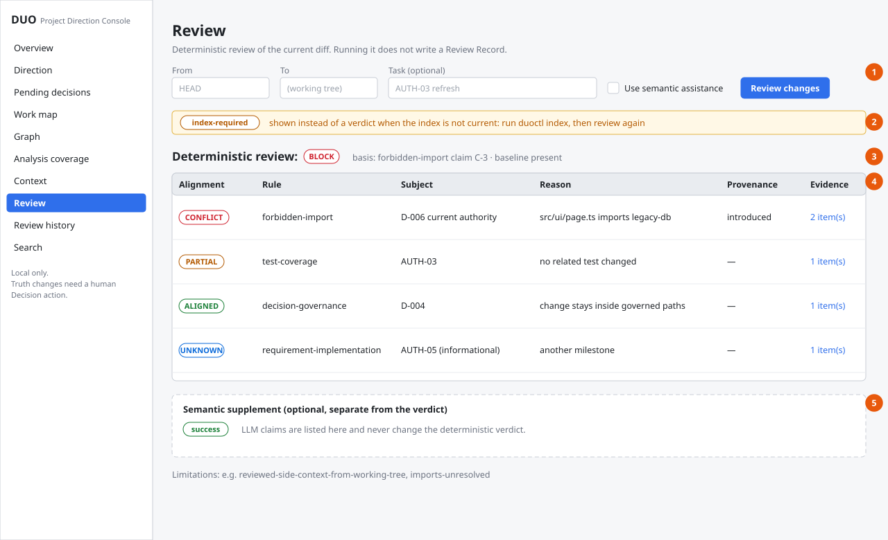
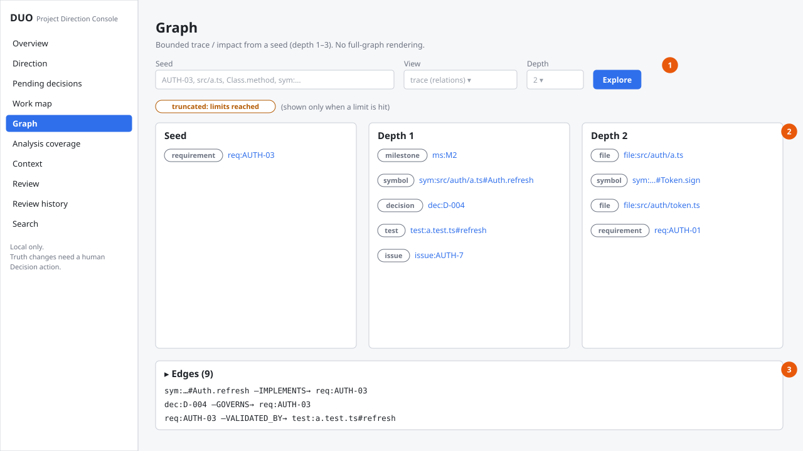
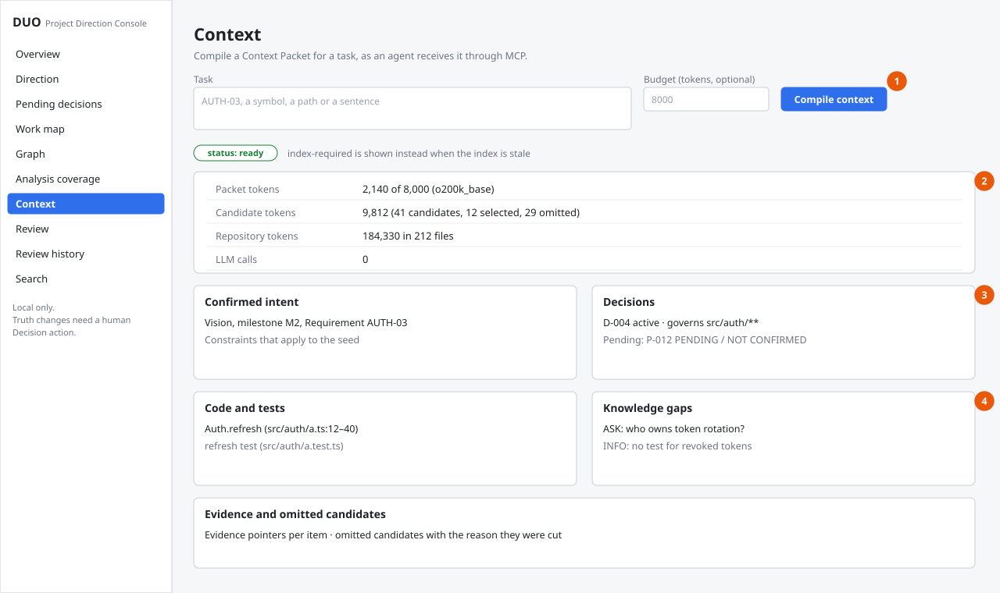

# DUO 화면 와이어프레임

`duoctl ui`로 여는 로컬 웹 UI(**Project Direction Console**)의 화면 구조입니다. 실제 구현(`packages/ui/src`)의 메뉴, 입력 칸, 버튼, 표 열을 그대로 옮긴 저충실도(lo-fi) 와이어프레임이며, 화면 속 데이터는 예시입니다. 화면 규칙은 [08. UI Spec](../08-ui-spec.md)에 있습니다.

- **실행:** 저장소에서 `duoctl ui --open`. `127.0.0.1`에서만 열리고, 터미널에 출력된 링크로 세션이 시작됩니다.
- **역할:** DUO의 주 사용 경로는 CLI와 에이전트용 MCP입니다. UI는 사람이 상태를 보고, 에이전트의 Decision 제안을 **확정하거나 거절**하는 곳입니다.
- **그림 속 주황색 번호**는 각 화면 아래 표의 설명과 짝을 이룹니다.

## 공통 레이아웃과 화면 흐름

모든 화면은 왼쪽 220px 메뉴와 오른쪽 본문으로 나뉩니다. 메뉴 10개는 어느 화면에서든 바로 이동할 수 있고, 아래 그림은 화면 안의 링크로 이어지는 이동 경로만 보여 줍니다.

| 화면 | 하는 일 |
|---|---|
| Overview | 프로젝트, milestone, index 신선도, baseline, Requirement·Decision 수, 대기 중 Decision, 최근 리뷰 |
| Direction | Vision, Milestone, Requirement, Constraint, Decision을 ID·상태·원본 위치로 탐색 |
| Pending decisions | 에이전트 제안(Proposal)을 사람이 확정하거나 거절 |
| Work map | 에이전트 작업과 관련 코드·Requirement·Decision을 관계 그래프로 표시 |
| Graph | 하나의 기준점(seed)에서 깊이 1–3까지 관계 탐색 |
| Analysis coverage | 언어별 분석 수준(L0/L1/L2)과 한계 |
| Context | 작업 설명으로 에이전트가 받는 Context Packet을 미리 생성 |
| Review | 현재 변경(diff)의 결정적 리뷰 판정과 근거 |
| Review history | 사람이 기록한 Review Record 목록 |
| Search | Requirement·Decision·Symbol·File·Review ID 검색 |

## 1. Overview

| 번호 | 설명 |
|---|---|
| 1 | Index 상태. 최신이면 `index current`, 오래되면 `Index required`와 실행할 명령(`duoctl index`)을 보여 줍니다. UI는 인덱스를 자동으로 다시 만들지 않습니다. |
| 2 | 사람의 확정을 기다리는 Decision 수. 누르면 Pending decisions로 갑니다. |
| 3 | 가장 최근에 기록된 리뷰의 판정(PASS·WARN·BLOCK)과 Review history 링크. 점수는 만들지 않습니다. |

## 2. Pending decisions (Decision 확정)

| 번호 | 설명 |
|---|---|
| 1 | 에이전트가 올린 Proposal 카드. 질문, 답, 근거, 적용 범위(Governs), 금지 규칙(Forbids), 강제 수준(Enforcement), 제안자(감사용 라벨)를 보여 줍니다. |
| 2 | `Confirm…`, `Reject…` 버튼. 에이전트는 이 단계를 할 수 없고 사람만 누를 수 있습니다. |
| 3 | 확인 창. CLI의 `duoctl decision confirm`과 같은 미리보기를 다시 보여 주고, 내용이 바뀌었는지(Stale)도 표시합니다. |
| 4 | Proposal ID를 직접 입력해야 `Confirm` 버튼이 켜집니다. 실수로 확정하는 것을 막습니다. 거절할 때는 사유를 남길 수 있습니다(선택, 2,000자 이하). |

## 3. Work map

| 번호 | 설명 |
|---|---|
| 1 | 작업 추가. Agent 이름, 작업 이름, 선택적으로 DUO Issue ID를 입력합니다. 에이전트가 MCP를 쓰면 자동으로도 기록됩니다. |
| 2 | 연결 상태 배너. 연결이 끊기면 "Reconnecting…", 확인이 두 번 실패하면 정보가 오래됐을 수 있다고 알립니다. |
| 3 | 관계 캔버스. 작업(보라), Truth(주황), 파일(청록), 테스트(자주)를 선으로 잇습니다. 캔버스 안에서 이동·확대합니다. |
| 4 | 선택한 노드의 상세와 연결 목록. 깊이를 골라 더 펼치거나, 작업을 완료 처리합니다. |

## 4. Review

| 번호 | 설명 |
|---|---|
| 1 | 리뷰 범위(From·To), 작업 설명, 선택적 LLM 보조. 리뷰를 실행해도 Review Record는 자동으로 저장되지 않습니다. |
| 2 | 인덱스가 최신이 아니면 판정 대신 `index-required`를 보여 줍니다. |
| 3 | 결정적 판정(PASS·WARN·BLOCK)과 그 근거가 된 claim. |
| 4 | Claim 표: Alignment, Rule, Subject, Reason, Provenance(Adoption Baseline 대비), Evidence. 예: Decision이 금지한 import는 `CONFLICT`, `forbidden-import`. |
| 5 | LLM 보조 결과는 별도 영역에 표시되며 결정적 판정을 바꾸지 않습니다. |

## 5. Graph

| 번호 | 설명 |
|---|---|
| 1 | 기준점(Requirement ID, 파일, Symbol 등), 보기(trace 또는 impact), 깊이(1–3). 전체 그래프를 한 번에 그리지 않습니다. |
| 2 | 깊이별 노드 목록. 노드를 누르면 그 노드에서 다시 탐색하거나 Entity 상세로 갑니다. |
| 3 | 엣지 목록(접기·펼치기). 예: `IMPLEMENTS`, `GOVERNS`, `VALIDATED_BY`. 엣지 의미는 [ERD](erd.md#엣지관계-정의--10종)에 있습니다. |

## 6. Context

| 번호 | 설명 |
|---|---|
| 1 | 작업 설명과 선택적 토큰 예산. 에이전트가 MCP `duo_get_context`로 받는 것과 같은 Context Packet을 만듭니다. |
| 2 | 토큰 지표: Packet 크기, 후보 중 선택·제외 수, 저장소 전체 토큰, LLM 호출 수(기본 0). |
| 3 | 확정된 의도(Vision, Milestone, Requirement, Constraint)와 Decision. 확정되지 않은 제안은 `PENDING / NOT CONFIRMED`로 구분합니다. |
| 4 | 관련 코드·테스트와 지식 공백(사람에게 물어야 할 것). 근거 위치와 제외된 후보의 이유도 함께 보여 줍니다. |
