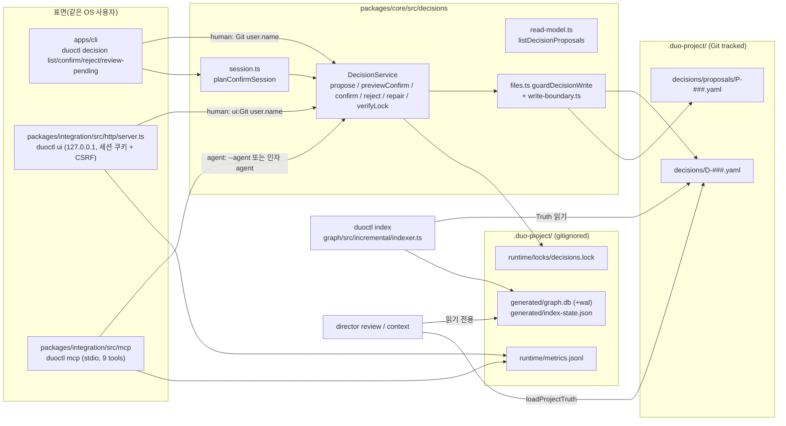

# 현재 Backend 구조와 Decision 데이터 흐름(T87)

기준: `next` = `9d6a4e6`(공개 0.3.3과 같은 제품 코드, 그 뒤 문서 커밋만 있음). 이 문서는 코드를 바꾸지 않고 현재 구조를 적는다. 권한·감사 설계는 [decision-rbac-design.md](decision-rbac-design.md)와 [decision-audit-gap.md](decision-audit-gap.md), API 계약은 [backend-api-contract.md](backend-api-contract.md)에 있다.

## 1. 한눈에 보기

DUO는 서버가 없는 로컬 도구다. 모든 표면(CLI, 로컬 UI 서버, MCP 서버)은 사용자의 OS 계정으로 같은 저장소의 파일을 읽고 쓴다. Decision을 쓰는 곳은 core의 `DecisionService` 하나이고, 세 표면 모두 그것을 호출한다. 그래프(SQLite)는 다시 만들 수 있는 상태이며 Decision 쓰기와 직접 연결되지 않는다.

## 2. 모듈 책임표

| 패키지 | Decision·권한 관련 책임 | 쓰는 곳 | 주요 파일 |
|---|---|---|---|
| core | Truth 로딩·스키마 검증, Decision 생명주기, digest, 쓰기 경계, Truth 무결성 | `.duo-project/decisions/**`, decision lock | `decisions/service.ts`, `decisions/files.ts`, `decisions/digest.ts`, `decisions/integrity.ts`, `decisions/read-model.ts`, `decisions/session.ts`, `schema/schemas.ts`, `loader/project.ts`, `loader/authority.ts`, `write-boundary.ts` |
| graph | SQLite GraphStore(WAL, `BEGIN IMMEDIATE`, busy_timeout 5000 ms), 증분 인덱스 | `generated/graph.db`, `generated/index-state.json` | `store/node-sqlite/node-sqlite-graph-store.ts`, `incremental/indexer.ts`, `incremental/state.ts` |
| director | Review(R-LOCK 포함 규칙), Context Packet, Review 기록, runtime metrics | `reviews/`(사람이 기록할 때만), `runtime/metrics.jsonl` | `review/rules.ts`, `review/record.ts`, `context/compile.ts`, `runtime/metrics.ts` |
| integration | 공유 operation, 로컬 UI HTTP 서버, MCP 서버, Agent 설치 | Decision은 core 경유. Agent 설정 파일 4개 | `http/server.ts`, `http/projection.ts`, `operations/propose.ts`, `mcp/tools.ts`, `mcp/server.ts`, `agents/*` |
| ui | React 화면. 쓰기는 confirm/reject 두 POST뿐 | 없음 | `src/api.ts`, `src/types.ts`, `src/pages/decisions.tsx`, `src/pages/reviews.tsx` |
| apps/cli | 명령 파싱, TTY 확인, 사람 actor 결정 | core 경유 | `commands/decision.ts`, `commands/decision-session.ts`, `commands/shared.ts`(`humanActor`), `commands/status.ts`, `commands/doctor.ts` |

## 3. 저장 위치

| 위치 | Git | 내용 | 쓰는 주체 |
|---|---|---|---|
| `.duo-project/decisions/D-###.yaml` | tracked | 확정·대체된 Decision. `proposal`, `proposed_by(_kind)`, `proposed_at`, `confirmed_by`, `confirmed_at`, `lock.digest`, `supersedes`/`superseded_by` | DecisionService(human actor만, `guardDecisionWrite`) 또는 사람의 직접 편집(ADR-013 fallback) |
| `.duo-project/decisions/proposals/P-###.yaml` | tracked | 대기·거절된 제안. `based_on`(truth digest, refs), 거절 시 `rejected_by/at`, `reason`. **확정되면 파일이 지워진다** | DecisionService(모든 actor) |
| `.duo-project/runtime/locks/decisions.lock` | ignored | `{pid, host, acquiredAt}`. 독점 생성, 같은 host의 죽은 pid만 깨뜨림 | DecisionService |
| `.duo-project/runtime/metrics.jsonl` | ignored | surface·명령·상태·시각. Decision ID와 actor는 없음 | UI, MCP, CLI |
| `.duo-project/generated/graph.db` | ignored | Project Graph | `duoctl index` |
| `.duo-project/reviews/*.json` | tracked | 사람이 남긴 Review 기록, adoption baseline | Review 기록(사람) |

## 4. 기능별 분석

| 기능 | 진입점 | 입력 → 출력 | 비즈니스 로직 | Lock·원자성 | 실패 처리 | 호출자 식별 | 권한 검사 | 테스트 |
|---|---|---|---|---|---|---|---|---|
| Propose | MCP `duo_propose_decision` → `operations/propose.ts` → `service.propose`. CLI·UI에는 propose가 없다 | `ProposalInput` → `P-###` 경로, `basedOn` | 스키마·trace 규칙으로 미리 검증, supersede 대상은 confirmed만 | decisions.lock 안. 새 파일은 임시 파일 + hard link로 독점 생성(ID 경쟁 시 다음 번호) | `PROPOSAL_INVALID` 등 진단, 아무것도 쓰지 않음 | `{kind:"agent", name: args.agent ?? --agent ?? "agent"}`. 이름은 자유 문자열 | `DECISION_PERMISSIONS.propose` = human/agent/system | `service.test.ts`, `mcp/propose-contract.test.ts` |
| Preview | CLI confirm/reject 전, UI `GET /api/proposals`(pending마다 `previews[id]`) | ID → `ConfirmPreview`(candidate, proposer, stale, supersedes, digest) | confirm과 같은 candidate 읽기(`candidateOf`) | lock 없음, 쓰기 없음 | 진단 반환 | 해당 없음 | 없음(읽기) | `service.test.ts` |
| Confirm(proposal) | CLI `decision confirm`(TTY + ID 재입력), CLI `review-pending`, UI `POST /api/proposals/{id}/confirm`(ID 재입력 + `previewDigest` 필수) | ID, `expectedDigest` → `D-###` | lock 안에서 repair → candidate 다시 읽기 → digest 비교 → 스키마·trace 검증 → `D-###` 독점 생성(commit 지점) → 대체 대상 표시 → proposal 삭제 | 생성이 commit 지점. 이후 단계 실패는 warning, 다음 조작의 repair가 마무리 | `DECISION_CONFIRM_PREVIEW_CHANGED`, `DECISION_LOCK_BUSY`(5000 ms), `PROPOSAL_NOT_PENDING` 등 | CLI: Git `user.name`. UI: `ui:` + Git `user.name`. 둘 다 kind는 코드에 고정된 human | service: human만. `guardDecisionWrite`: Decision 파일은 human만 | `service.test.ts`(26), `session.test.ts`(5), `http/server.test.ts`(13), `tests/cli/existing-project.e2e.test.ts` |
| Confirm(D-### in place / lock 추가) | CLI만(UI는 `P-` ID만 받음) | `D-###` → 같은 ID | proposed YAML → confirmed, 또는 lock 없는 confirmed에 lock 추가 | 같은 lock | 같음 | 같음 | 같음 | `service.test.ts` |
| Reject | CLI `decision reject [--reason]`, UI `POST /api/proposals/{id}/reject` | proposal ID, reason → 같은 파일 | proposal 파일에 `state: rejected`, `rejected_at`, `rejected_by`, `reason`을 제자리 기록 | 같은 lock, 원자적 교체 | `PROPOSAL_NOT_PENDING`, Decision ID는 `DECISION_LOCKED` | 위와 같음 | human만 | `service.test.ts` |
| Supersede | 별도 명령 없음. `supersedes`가 있는 proposal의 confirm | 위와 같음 | 새 Decision 생성 후 대상에 `state: superseded`, `superseded_by` | 대상 표시는 commit 뒤 단계. 실패하면 repair | `DECISION_SUPERSEDE_TARGET_INVALID` | 위와 같음 | 위와 같음 | `service.test.ts`, `integrity.test.ts` |
| Repair | 모든 쓰기 조작의 시작, `repairDecisionState` | 없음 → `repaired[]`(문자열) | 이미 Decision이 된 proposal 삭제, 대체 대상 표시 | lock 안 | 결과는 반환만 하고 파일에 기록하지 않음. MCP propose 응답에는 `repaired`가 빠진다 | system | 없음 | `service.test.ts` |
| Lock·무결성 검사 | loader(`decisionAuthorityDiagnostics`), Review R-LOCK, `verifyLock` | Decision → 상태/진단 | 내용 필드 sha256과 `lock.digest` 비교, 생명주기 모순 | 읽기 | `DECISION_INTEGRITY_INVALID`(error) → `requireCompleteTruth`가 review·context·생명주기를 막음 | 해당 없음 | 해당 없음 | `integrity.test.ts`(12), `review.e2e.test.ts` |
| Index | CLI `duoctl index`(MCP에는 없음, #4) | 파일 → graph.db | 증분 분석, 한 트랜잭션에 그래프와 state token | SQLite `BEGIN IMMEDIATE`, busy 5000 ms. decisions.lock과는 별개 | BUSY 진단 | 해당 없음 | 해당 없음 | graph 테스트 |
| Review·Context | CLI, UI POST, MCP 읽기 도구 | diff/task → verdict, packet | Truth + 그래프 읽기. stale 그래프면 `index-required` | 읽기 전용 그래프 | `INDEX_REQUIRED` | 해당 없음 | 없음(읽기) | director e2e |

## 5. 세 표면이 같은 규칙을 쓰는가

같다. CLI, UI, MCP 모두 `createDecisionService`를 호출하고 business logic을 복제하지 않는다(ADR-013). pending 여부도 세 곳 모두 `listDecisionProposals`가 정한다. 그래서 표면 사이의 규칙 불일치보다 아래의 구조적 한계가 더 중요하다.

1. **actor는 호출자가 정한다.** `DECISION_PERMISSIONS` 검사는 `actor.kind`만 본다. CLI와 UI는 kind를 human으로 고정해 넘기고 이름은 Git `user.name`에서 읽는다. MCP는 agent로 고정하지만 이름은 인자로 받는다. 인증된 신원은 어디에도 없다(docs/10-security.md도 같은 내용).
2. **사람용 경로를 에이전트가 조작할 수 있다.** T87 재현에서 셸 도구가 PTY를 열어 `duoctl decision confirm P-003`에 ID를 입력해 확정했고, 같은 셸에서 `duoctl ui`를 띄워 launch URL과 CSRF 토큰을 읽어 API로 확정·거절했다. TTY, ID 재입력, 세션 쿠키, CSRF는 실수와 다른 웹 페이지를 막는 장치이지 사람과 에이전트를 구분하지 않는다.
3. **파일을 직접 쓰면 서비스를 거치지 않는다.** lock이 없는 `D-###.yaml`은 ADR-013의 수동 fallback이라 확정 Decision으로 인정된다(재현 S7c: 오류 0건). lock digest도 누구나 다시 계산할 수 있다(`digest.ts` 주석).
4. **표면별 기능 차이.** CLI만 `D-###` 제자리 confirm과 `review-pending`을 지원하고, UI는 `P-` ID만 받는다. 사람이 proposal을 만드는 명령은 어느 표면에도 없어 사람의 제안은 파일을 손으로 써야 한다.
5. **확정 직후 그래프는 낡는다.** confirm은 `indexRequired: true`만 돌려주고 그래프를 고치지 않는다. MCP로 일하는 에이전트는 index를 돌릴 수 없어 다음 context·review가 `INDEX_REQUIRED`가 된다(#4, Jira S15P31A106-321).
6. **두 lock은 서로 모른다.** Decision 쓰기는 decisions.lock, 인덱스는 SQLite lock을 쓴다. 확정과 index가 동시에 돌 때의 결과는 #34(AI-4)의 조사 대상이다.

## 6. 호환성 경계(바꾸면 공개 계약이 깨지는 곳)

| 경계 | 형식 | 비고 |
|---|---|---|
| Truth 파일 | `DecisionSchema`, `ProposalSchema`(zod `strictObject`) | 모르는 키는 loader 오류. 새 필드는 스키마 확장과 이전 버전 호환 판단이 필요하다 |
| UI API | `duo.ui.<name>/1` envelope, 오류 `duo.ui.error/1` | 도메인 실패는 HTTP 200 + `data.status: "failed"`. 전송·보안 오류만 4xx |
| MCP | 9개 tool 이름과 입력·출력 스키마 | `propose-contract.test.ts`가 confirm/reject/write 도구가 없음을 고정 |
| CLI | `duo.cli.<command>/1` JSON, 종료 코드 | `CLI_TTY_REQUIRED` 종료 코드 1 |
| Decision Lock | 내용 필드 9개의 canonical JSON sha256 | 대상 필드를 바꾸면 기존 lock이 모두 깨진다 |

## 7. 기존 테스트 증거

| 테스트 | 고정하는 것 |
|---|---|
| `packages/core/src/decisions/service.test.ts` | agent·system confirm/reject 거부(`DECISION_ACTOR_FORBIDDEN`), preview digest 바인딩, lock busy, repair, supersede |
| `packages/core/src/decisions/integrity.test.ts` | lock 불일치·생명주기 모순 감지 |
| `packages/core/src/decisions/session.test.ts` | review-pending 계획의 순서·충돌 거부 |
| `packages/integration/src/http/server.test.ts` | 세션·CSRF·Origin·Host 검사, ID 재입력, `previewDigest` 필수 |
| `packages/integration/src/mcp/propose-contract.test.ts` | 9개 tool, confirm/reject 도구 없음, proposal 입력 제한 |
| `tests/cli/existing-project.e2e.test.ts` | TTY가 아니면 confirm 거부 |
| `packages/director/src/review/review.e2e.test.ts` | R-LOCK 판정 |

없는 테스트: 셸 도구가 PTY로 CLI를 조작하는 경우, 같은 사용자의 다른 프로세스가 UI API를 쓰는 경우, lock 없는 Decision 파일을 에이전트가 만든 경우. 지금 구조에서는 막을 수 없으므로 테스트가 아니라 설계 문제로 다룬다([decision-rbac-design.md](decision-rbac-design.md)).

